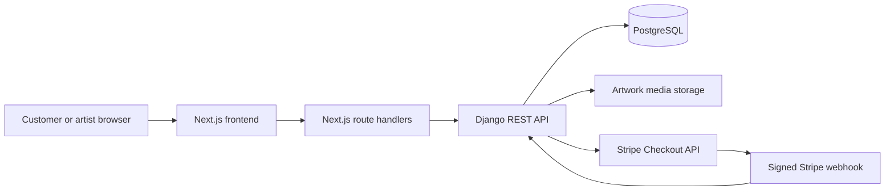

# EAMORA Art Platform

[](https://github.com/Raya-Khabiri/artist-website/actions/workflows/ci.yml)
[](https://eamora.art)

EAMORA is a production full-stack portfolio and e-commerce platform for an independent artist. It combines a public artwork gallery, secure customer accounts, direct artist messaging, live Stripe payments, and a private studio dashboard for managing content, inventory, orders, and enquiries.

Designed and developed by **Raya Khabiri** as a production software engineering portfolio project.

**Live application:** [https://eamora.art](https://eamora.art)

## Highlights

- Responsive public gallery with filtering, sorting, artwork detail pages, and image galleries
- Original artwork and print purchasing flows with a persistent basket
- Secure Stripe Checkout integration with signed webhook verification
- Server-side price, availability, quantity, and payment validation
- Customer registration, authentication, account messaging, and unread notifications
- Staff-only studio dashboard for artwork, order, media, and site-content management
- PostgreSQL persistence with Django migrations and automated tests
- Dynamic metadata, structured data, canonical URLs, robots rules, and XML sitemap
- Docker-based local and production environments
- GitHub Actions continuous integration and automated production deployment

## Architecture



The browser communicates with same-origin Next.js route handlers. These server-side handlers securely forward authenticated requests to Django without exposing backend credentials or access tokens to client-side code. Django owns business rules, persistence, permissions, order creation, and payment verification.

## Technology Stack

### Frontend

- Next.js 16 with the App Router
- React 19 and TypeScript
- Tailwind CSS 4
- Server and client components
- Route handlers as a backend-for-frontend layer

### Backend

- Python 3.12
- Django 5.2
- Django REST Framework
- Simple JWT authentication
- PostgreSQL 17 with Psycopg
- Pillow for artwork image processing
- Gunicorn and WhiteNoise

### Infrastructure and Services

- Docker and Docker Compose
- Stripe Checkout and webhooks
- GitHub Actions CI/CD
- Cloudflare and HTTPS in production

## Core Features

### Public experience

- Homepage content managed through the artist dashboard
- Search-engine-friendly artwork gallery and detail pages
- Technique and availability filters
- Artwork dimensions, descriptions, pricing, and sale status
- Responsive images and lightbox galleries
- About, contact, shipping, privacy, and terms pages

### Customer experience

- Email-based registration and sign-in
- Persistent basket with quantity controls
- Authenticated checkout and delivery details
- Stripe-hosted payment page
- Payment confirmation using Stripe Checkout session data
- Customer-to-artist conversations and message notifications

### Artist studio

- Staff-only dashboard and API permissions
- Create, edit, publish, feature, and archive artworks
- Upload a primary image and ordered gallery images
- Manage inventory, prices, availability, dimensions, and image alternative text
- Review orders and update fulfilment status
- Manage homepage, artist profile, media, and contact content
- Read and respond to customer conversations

## Payment Security

The client never supplies authoritative prices. Django rebuilds each order from database records, validates stock and product type, calculates totals server-side, and creates the Stripe Checkout Session.

Payment completion is verified using signed Stripe webhook events. Live API keys and webhook secrets are stored only as production environment variables and are never committed to the repository.

## Local Development with Docker

### Prerequisites

- Docker Desktop with Docker Compose
- Git

### Setup

1. Clone the repository:

   ```bash
   git clone https://github.com/Raya-Khabiri/artist-website.git
   cd artist-website
   ```

2. Create the environment file:

   ```bash
   cp .env.example .env
   ```

   On PowerShell:

   ```powershell
   Copy-Item .env.example .env
   ```

3. Replace the placeholder values in `.env`. Use Stripe **test-mode** credentials for local development.

4. Build and start the application:

   ```bash
   docker compose up --build
   ```

5. Create an artist administrator account:

   ```bash
   docker compose exec backend python manage.py createsuperuser
   ```

6. Open the applications:

   - Frontend: [http://localhost:3000](http://localhost:3000)
   - Django admin: [http://localhost:8000/admin/](http://localhost:8000/admin/)

## Environment Variables

The committed `.env.example` documents the required configuration. Important variables include:

| Variable | Purpose |
| --- | --- |
| `DJANGO_SECRET_KEY` | Django cryptographic signing key |
| `DJANGO_DEBUG` | Enables or disables Django debug mode |
| `DJANGO_ALLOWED_HOSTS` | Permitted backend hostnames |
| `DB_*` | PostgreSQL connection settings |
| `FRONTEND_URL` | Canonical frontend URL used for trusted redirects |
| `STRIPE_SECRET_KEY` | Server-side Stripe API credential |
| `STRIPE_WEBHOOK_SECRET` | Stripe webhook signing secret |

Never commit `.env`, production credentials, database exports, or customer information.

## Quality Checks

Run backend validation and tests:

```bash
python manage.py check
python manage.py test
```

Run frontend validation:

```bash
cd frontend
npm ci
npm run lint
npm run build
```

## CI/CD

GitHub Actions provides two workflows:

### Continuous integration

Pull requests and pushes to `main` run:

- PostgreSQL 17 service provisioning
- Django system checks
- Complete backend test suite
- Frontend dependency installation with `npm ci`
- ESLint validation
- Optimised Next.js production build

### Production deployment

Pushes to `main` can deploy through an SSH-based production workflow. Deployment uses strict host-key verification, performs a fast-forward-only pull, and rebuilds the Docker Compose services on the server. Infrastructure credentials are stored as GitHub Actions secrets.

## Repository Structure

```text
accounts/       Authentication, profiles, conversations, and messages
artworks/       Artwork catalogue, images, filtering, and studio APIs
orders/         Checkout, Stripe integration, orders, and fulfilment
sitecontent/    Artist-managed public website content
config/         Django project configuration
frontend/       Next.js application and backend-for-frontend routes
.github/        Continuous integration and deployment workflows
```

## Privacy and Portfolio Notice

Production secrets, customer records, database backups, and private operational data are excluded from this repository. Public artwork images and brand assets remain the intellectual property of their respective owner and are not licensed for reuse.

This repository is published for educational assessment and portfolio review.
